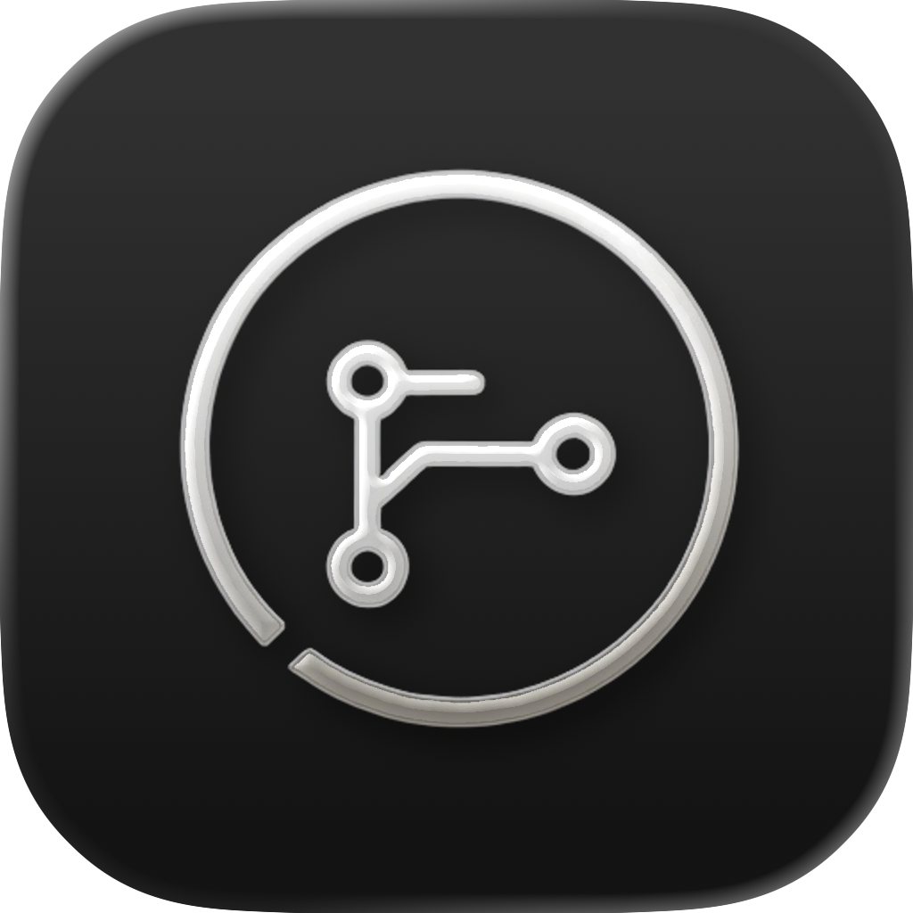
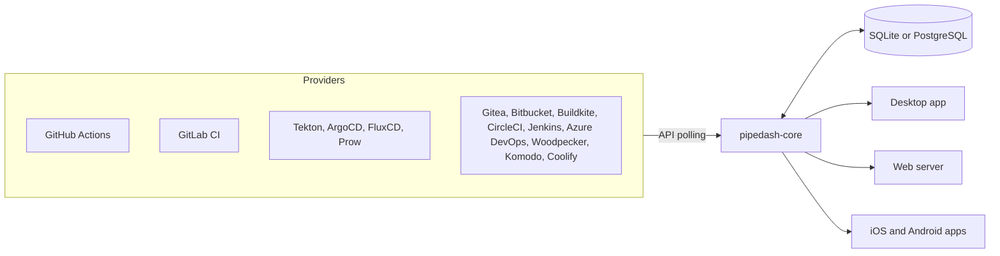

   
  
  <h1>Pipedash</h1>
  
One dashboard for the CI/CD pipelines of every provider you use.

  <a href="https://pipedash.app">Website</a> | <a href="https://pipedash.app/downloads">Downloads</a> | <a href="https://pipedash.app/docs">Docs</a>
    
  
    
  
  
  
  
   
  
  
    

  

## Screenshots

<b>Desktop and web</b> (9 pages)

<table>
  <tr>
    <td align="center" width="33%"><b>Pipelines</b> </td>
    <td align="center" width="33%"><b>Run history</b> </td>
    <td align="center" width="33%"><b>Run details</b> </td>
  </tr>
  <tr>
    <td align="center" width="33%"><b>Job logs</b> </td>
    <td align="center" width="33%"><b>Trigger a workflow</b> </td>
    <td align="center" width="33%"><b>Metrics</b> </td>
  </tr>
  <tr>
    <td align="center" width="33%"><b>Provider status</b> </td>
    <td align="center" width="33%"><b>Notifications</b> </td>
    <td align="center" width="33%"><b>Providers</b> </td>
  </tr>
</table>

<b>Mobile</b> (9 pages)

<table>
  <tr>
    <td align="center" width="33%"><b>Pipelines</b> </td>
    <td align="center" width="33%"><b>Run history</b> </td>
    <td align="center" width="33%"><b>Run details</b> </td>
  </tr>
  <tr>
    <td align="center" width="33%"><b>Job logs</b> </td>
    <td align="center" width="33%"><b>Trigger a workflow</b> </td>
    <td align="center" width="33%"><b>Metrics</b> </td>
  </tr>
  <tr>
    <td align="center" width="33%"><b>Provider status</b> </td>
    <td align="center" width="33%"><b>Notifications</b> </td>
    <td align="center" width="33%"><b>Providers</b> </td>
  </tr>
</table>

## About

Pipedash shows the pipelines of all your CI/CD providers in one table, so you stop switching between dashboards to find the build that failed. It polls each provider with the token or kubeconfig you add and caches the results. From the same table you open, trigger, rerun and cancel runs.

It runs as a desktop app, as a self-hosted web server in Docker or as an iOS and [Android](https://pipedash.app/android) app. All of them share one Rust core.

## Supported providers

GitHub Actions, Gitea Actions, GitLab CI, Bitbucket Pipelines, Buildkite, CircleCI, Jenkins, Azure DevOps Pipelines, Woodpecker CI, Tekton CD, ArgoCD, FluxCD, Prow, Komodo Stacks and Coolify applications. Each one is a plugin crate. The [providers guide](https://pipedash.app/docs/providers) lists the token and permissions each provider needs.

Buildkite's organization picker and pipeline discovery include organizations from every API page.

View [Gitea](https://pipedash.app/docs/providers) workflow status, history and run details across server-capped API pages.

See dead [Coolify](https://pipedash.app/docs/providers) containers as failed with a `Dead` resource label.

Follow new [Jenkins](https://pipedash.app/docs/providers) folder and multibranch jobs automatically with the opt-in "Follow all jobs" setting.

## Features

- See pipeline status across providers and pin or hide workflows in the [dashboard](https://pipedash.app/docs/features/dashboard).
- Organize pipelines into nested views with rules, layouts and bulk actions in the [views guide](https://pipedash.app/docs/features/views). Sidebar names update when another connected client renames a view.
- Open the run history with commits, branches and durations, and track build metrics per pipeline. The run history updates when another connected client discovers new runs. Metrics refreshes advance the selected time range to include runs that finish after you open the page.
- Reselect a pipeline to load its latest [run history](https://pipedash.app/docs/features/run-history) without clearing the cache manually.
- Read, search and download [job logs](https://pipedash.app/docs/features/run-logs) without leaving Pipedash.
- Choose a Tekton sidecar under its task to read its [logs](https://pipedash.app/docs/features/run-logs) separately on desktop and web.
- Downloaded Tekton [task logs](https://pipedash.app/docs/features/run-logs) stay available after upgrades when TaskRuns disappear or their listing fails.
- Open an ArgoCD sync to read its per-resource results, the app's recent events and the last 1000 lines of each pod container. A restarted container also shows its previous attempt. Pod logs need the `logs, get` permission in ArgoCD RBAC.
- Sign in to ArgoCD with its SSO (bundled Dex or an external OIDC provider), or to a Prow Deck behind any OpenID Connect provider, instead of pasting a token. Pipedash renews the session before it expires and asks you to sign in again when the identity provider ends it. In the self-hosted web app, you paste the address of the page the browser opens after sign-in, unless Pipedash runs on the same machine as the browser.
- Monitor a public Prow Deck without credentials through its [read-only connection](https://pipedash.app/docs/providers/prow).
- Trigger workflows with provider inputs, clear CircleCI string defaults or rerun past runs through the [trigger guide](https://pipedash.app/docs/features/trigger-and-cancel).
- Cancel runs, approve GitHub deployment reviews and rerun failed jobs through the [run history guide](https://pipedash.app/docs/features/run-history).
- Force cancel stuck GitHub runs through the [trigger guide](https://pipedash.app/docs/features/trigger-and-cancel#force-cancel-on-github).
- See why GitHub disabled a workflow and enable it again with the [GitHub Actions guide](https://pipedash.app/docs/providers/github-actions#disabled-workflows).
- Choose per-device alerts, mutes and pipeline watches in the [notifications guide](https://pipedash.app/docs/features/notifications).
- Connect phones and computers to a server or sharing desktop through [Server mode](https://pipedash.app/docs/deployment/server-mode).
- Get background alerts on phones and push alerts on iPhone and iPad through the [notifications guide](https://pipedash.app/docs/features/notifications).
- Keep provider tokens in the system keyring or in a database encrypted with AES-256-GCM. Pipedash sends no analytics or telemetry.

## Get started

Download the [desktop app](https://pipedash.app/downloads), install the [iOS app](https://apps.apple.com/br/app/pipedash-ci-cd-monitoring/id6757285870?l=en-GB), join the [Android beta](https://pipedash.app/android) or run the [Docker image](https://pipedash.app/docs/deployment/docker). The [quick start](https://pipedash.app/docs/getting-started/quick-start) walks through your first provider.

To install the self-hosted web app on iPhone, open it in Safari and choose Share > Add to Home Screen. Keep "Open as Web App" enabled when available. Its manifest covers the deployment base path and starts the app at that root. After deploying changes to scope, status-bar settings or icon artwork, add a new Home Screen icon to avoid cached installation metadata.

Move storage with retained run history and metrics from Settings or the config editor on desktop and web with the [storage guide](https://pipedash.app/docs/configuration/storage-backends).

Browse and sort [run history](https://pipedash.app/docs/features/run-history), using complete scans for oldest-first order and a load-more prompt when needed.

Clear cached run history in Settings with the controls in the [cache guide](https://pipedash.app/docs/features/cache).

The config editor expands environment references for validation and keeps them unchanged when you save.

- [Configuration](https://pipedash.app/docs/configuration): `config.toml`, environment variables, secrets and provider refresh intervals that take effect during startup.
- [Storage and tokens](https://pipedash.app/docs/configuration/storage-backends): SQLite, PostgreSQL and token encryption.
- [REST API](https://pipedash.app/docs/deployment/rest-api): routes, authentication and WebSocket events. Metrics queries reject invalid types and require RFC 3339 dates with a timezone.
- [Architecture](https://pipedash.app/docs/resources/architecture): crates, refresh loop and plugin system.
- [Security](https://pipedash.app/docs/resources/security): encryption, API authentication and vulnerability reports.
- [Releases](https://github.com/hcavarsan/pipedash/releases): changes and release assets.

## Desktop menu and background monitoring

In Settings > General, turn on "Show in menu bar" on macOS or "Show in system tray" on Windows and Linux. The menu shows the first 8 pinned pipelines, an overflow link and your pinned views and repositories. It uses the same pins as the main window.

Background mode is a separate opt-in. On macOS and Windows, closing the window hides it while monitoring continues. On Linux, closing minimizes the window so it stays accessible without a tray host. Your desktop may need an indicator extension. Use "Quit Pipedash" to stop the app.

Choose a run from its history to watch that exact run. Pipedash watches 1 run at a time, with or without the tray. Stopping a watch does not cancel the provider's run. The native menu has shortcuts to the watched run, refresh, settings and vault locking.

Turn on system notifications in Settings > Notifications. Desktop alerts and watch completion notices work without a visible window. The notification center keeps the latest 50 notices for the current session, including notices received while system notifications are off. Locking, changing storage, resetting or quitting clears that history. A watched failure and a general pipeline failure are separate notices.

See alerts missed during a server disconnection in the desktop [notification center](https://pipedash.app/docs/features/notifications) after reconnecting.

The operating system decides whether to display an alert. Do Not Disturb may suppress it. On Windows, install Pipedash for its notification identity. Open a Windows notification while its toast is visible. Action Center cannot reopen Pipedash after that toast disappears, so the app and native menu remain the navigation paths.

## Contributing

Read the [contribution guide](https://pipedash.app/docs/resources/contributing). For local builds, see [development](https://pipedash.app/docs/resources/development). To add a CI/CD provider, see [plugin development](https://pipedash.app/docs/resources/plugin-development).

Run `mise install` before local checks. Rust is pinned to `nightly-2026-10-31` in `mise.toml` and `rust-toolchain.toml` because the November 1 nightly fails to compile the Linux `zbus` dependency; keep both pins aligned when upgrading. Use `cargo fmt` without a toolchain override to keep formatting on the same version.

CI runs backend tests on Linux, macOS and Windows, including log-resume checks that preserve the previous revision while truncating and extending a copied checkpoint.

Run `cargo nextest run --workspace --all-features` for Rust regressions and see [development](https://pipedash.app/docs/resources/development) for frontend checks.

Regenerate and check app icons with the [development guide](https://pipedash.app/docs/resources/development).

Report bugs or request features through [GitHub issues](https://github.com/hcavarsan/pipedash/issues). For help, see [support](https://pipedash.app/support).

## License

Pipedash is licensed under [GPL-3.0](LICENSE).

## Star History

<a href="https://star-history.com/#hcavarsan/pipedash&Date">
 <picture>
   <source media="(prefers-color-scheme: dark)" srcset="https://api.star-history.com/svg?repos=hcavarsan/pipedash&type=Date&theme=dark" />
   <source media="(prefers-color-scheme: light)" srcset="https://api.star-history.com/svg?repos=hcavarsan/pipedash&type=Date" />
   
 </picture>
</a>

## Contributors

