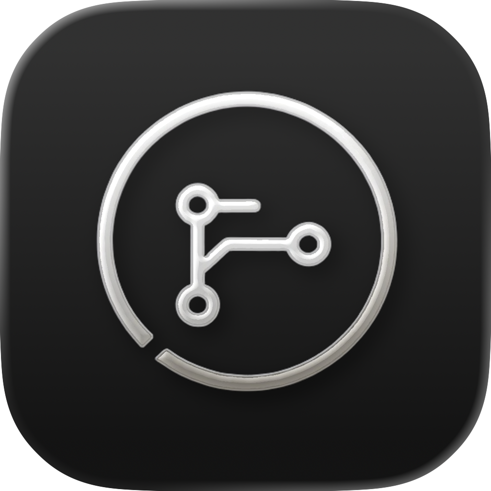
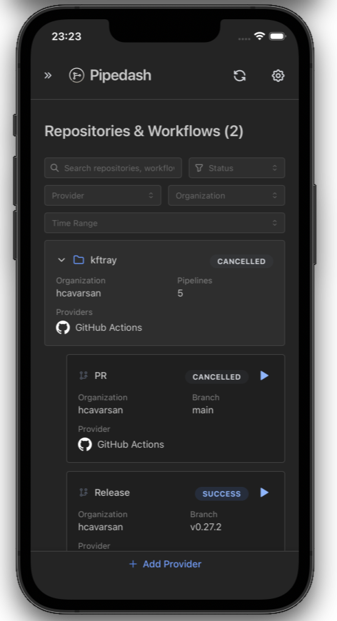

<div align="center">
  <br>
  
  <h1>Pipedash</h1>
  <p>Manage CI/CD pipelines from multiple providers (self-hosted, desktop, and mobile)</p>

  <a href="https://apps.apple.com/br/app/pipedash-ci-cd-monitoring/id6757285870?l=en-GB">
    
  </a>
</div>

<!-- The animated loop is served by pipedash.app from the pipedash-website repo (public/video). -->
<p align="center">
  <a href="https://pipedash.app">
    
  </a>
</p>


## About

Pipedash lets you see all your CI/CD pipelines in one place. Instead of jumping between GitHub Actions, GitLab CI, Buildkite, Jenkins, and Tekton dashboards, you get everything in a single view.

Built with Tauri, Rust, React, and TypeScript.

## Why

Most teams end up using multiple CI/CD platforms. Your open source projects run on GitHub Actions, internal services use GitLab CI or Buildkite, Kubernetes workloads use Tekton, and there's always that one Jenkins server handling legacy stuff. Checking everything means opening a bunch of tabs and hitting refresh.

Pipedash pulls your pipeline data from all these providers and shows it together.

## Supported providers

- GitHub Actions
- Gitea Actions
- GitLab CI
- Bitbucket Pipelines
- Buildkite
- Jenkins
- Tekton CD
- ArgoCD
- FluxCD

The plugin system makes it easy to add more.

## What it does

Pipedash polls your providers and shows pipelines organized by repo and workflow. Each provider has a configurable refresh interval. Status changes appear after the next successful refresh. On iOS, refreshes depend on the app running; this release does not promise monitoring while the app is closed.

What you can do:
- See pipeline status across all your providers
- Browse run history with commit info and execution times
- Trigger workflows with parameters (Pipedash loads them from each provider)
- Export your providers to a TOML file for another machine, with tokens left out as `${VAR}` references. On the other machine, Import under Settings > Providers adds each provider from the file that isn't set up there yet. It never reads tokens, so you add each one in the provider's edit dialog
- Rerun previous executions with the same parameters
- Cancel running builds, one at a time or several at once from the run history (tick the runs, then click "Cancel selected")
- Approve or reject a GitHub run that waits for a deployment review, from its row in run history (needs a required reviewer's token)
- Re-run only the failed jobs of a failed GitHub run, and the jobs that depend on them, from its row in run history. GitHub re-runs them on the same commit under the same run number, so this works for push and pull request runs too
- Pin workflows to the top of the table with the pin icon on a workflow row. Pins stay in the desktop app or in your browser, so each person on a shared web instance keeps their own
- Get a system notification when a refresh finds a newly failed run, including another failure on an already-failed pipeline, a run takes far longer than usual, or a provider has an outage or recovers. One Notifications switch under Settings > Notifications turns them all on. It's off by default and set per device. In the web UI, browsers allow it only over HTTPS or on localhost. On iOS, Pipedash also checks in the background when iOS allows it, using a separate copy of the provider credentials kept on the device; see [background checks](ios/README.md#background-checks-on-ios)
- WebSocket reconnection refreshes the web app's pipeline cache. The app reports a newly observed failure once, including a newer failed run on an already-failed pipeline. Recovery uses the latest snapshot. It cannot reconstruct every event missed while disconnected
- See when a running pipeline takes far longer than usual. Past 3 times the median duration of its recent successful runs, the status reads "Running longer than usual". With notifications on, you also get one system notification for that run. Flux resources are left out
- Add multiple instances of the same provider (e.g., two GitHub orgs)
- Keep watching GitHub repos without running out of API quota. With less than 10% of the hourly quota left, Pipedash stops refreshing that GitHub provider until the quota resets. The sidebar and Settings > Providers show "Paused until" with the reset time
- See when a provider has problems. Pipedash reads the public status pages of GitHub, GitLab.com, Bitbucket and Buildkite, and checks the Tekton and Flux controllers in your cluster. On GitHub, GitLab, Gitea, Jenkins, ArgoCD, Tekton and Flux providers you can also set the status page of your own instance. It only raises a warning for outages on the parts that runs depend on, such as Actions, the API, git and webhooks, and for problems reaching the provider. Click a provider in the table to see its service status, its controllers and Pipedash's connection to it. Outage and recovery alerts go to the bell in the header, which shows a dot while you have unread alerts. With notifications on, you also get a system notification
- Pick a dark, light, or system theme in Settings → General
- Drag the edge of the sidebar to resize it on desktop and web. Drag it narrow to collapse it to icons, and double-click the edge to reset its width
- Use keyboard shortcuts on desktop and web: `/` or Ctrl+K (⌘K on macOS) jumps to search, Ctrl+, opens Settings, and Ctrl+\ collapses the sidebar. The desktop app also has Ctrl+R to refresh everything and Ctrl+L to lock. On macOS these also live in the menu bar
- Right-click a pipeline, pinned workflow or run (or press Shift+F10) for the same actions as its buttons

Remote push notifications and Live Activities are disabled in the current iOS release. Local notifications remain optional; on iOS they also run background checks described in [background checks](ios/README.md#background-checks-on-ios).

When you trigger or rerun a workflow, Pipedash fetches available parameters from the plugin (workflow inputs for GitHub Actions, pipeline variables for GitLab CI, build parameters for Jenkins/Buildkite) and shows them in a form.

For GitHub Actions, Run and Rerun create a new `workflow_dispatch` run on the selected ref. An empty `204 No Content` response means GitHub accepted the dispatch.

For private repositories, GitHub fine-grained tokens need `Contents: Read` to load workflow inputs, in addition to `Actions: Read and write` to trigger runs. Add these permissions to each selected repository, including when updating an existing token. Classic PATs use `repo` for private repositories or `public_repo` for public repositories, plus `workflow`. The provider's permission check tests Contents access on every configured repository, or one accessible repository before selection.

**Privacy and security**

Pipedash runs on your device or your self-hosted server. It connects to the CI/CD providers, storage servers and optional proxy you configure. Unless you turn it off in Settings > General, it also checks public or configured provider status pages without credentials. It includes no analytics or telemetry. See the [privacy policy](PRIVACY.md) for storage destinations, retention, deletion and exported-copy limits.

Token storage options:

- **System keyring** (desktop and iOS) – Your OS protects tokens using macOS/iOS Keychain, Windows Credential Manager or Linux Secret Service. The iOS default is Device Keychain with an on-device SQLite database.
- **Encrypted SQLite** – Pipedash encrypts tokens with AES-256-GCM using Argon2id-derived keys. Works on all platforms.
- **Encrypted PostgreSQL** – Same AES-256-GCM encryption, stored in PostgreSQL. Use this with the PostgreSQL backend.

You can store pipeline data in SQLite or PostgreSQL on desktop and web. Switch backends through the setup wizard. iOS setup uses SQLite and Device Keychain. Advanced configuration can select remote storage, so device-only storage is the default rather than a guarantee for every configuration.

On iOS, Gitea and providers using the shared HTTP client require HTTPS, including redirect destinations. Desktop and web deployments retain their existing self-hosted HTTP support. Configure HTTPS before connecting an affected self-hosted provider from iOS.

**API Authentication** (web deployments)

When `PIPEDASH_VAULT_PASSWORD` is set, or after you set a vault password in the setup wizard or unlock screen, Pipedash requires authentication for API requests. The vault password serves dual purpose: encrypting your provider tokens AND securing API access. All requests except health, setup, plugin list and vault status, including vault lock and unlock, must include the header `Authorization: Bearer <vault_password>`. Locking the vault or a failed unlock never turns authentication off. If no vault password was set, the API remains open (suitable for local use or behind a VPN).

The API server also rejects `POST`, `PUT`, `PATCH`, and `DELETE` requests that a browser sends from another origin, so other sites can't change your instance through your browser. Requests without an `Origin` header, such as `curl` or scripts, are not affected. Set `PIPEDASH_CORS_ALLOW_ALL=true` to turn this check off when you serve the frontend from a different origin.

The first password that opens a vault stays bound to it, even before you add a provider and after a factory reset. Unlocking with another password fails.

## Deployment options

You can run Pipedash in three ways:

**Desktop app (Tauri)**

The main way to use Pipedash. It's a native desktop app for macOS, Windows, and Linux. By default, your tokens go in the system keyring. You can also use encrypted SQLite or PostgreSQL.

Download from the [releases page](https://github.com/hcavarsan/pipedash/releases).

**Docker deployment**

The `examples/` directory has ready-to-use setups with sample configs. Edit the compose file to add your tokens, then:

```bash
# SQLite backend (simplest)
mise run examples:sqlite:up
mise run examples:sqlite:down

# PostgreSQL backend
mise run examples:postgres:up
mise run examples:postgres:down
```

The API server serves the frontend directly (it's embedded in the binary). Pipedash encrypts your tokens with AES-256-GCM. Your data persists in a Docker volume. See [Docker setup](#docker-setup) for details.

## Installation

**Desktop**: Grab the latest release for your platform from the [releases page](https://github.com/hcavarsan/pipedash/releases). Works on macOS, Windows, and Linux.

**iOS**: Download from the [App Store](https://apps.apple.com/br/app/pipedash-ci-cd-monitoring/id6757285870?l=en-GB).

## Setup

Launch the app and add a provider via the sidebar. Each provider needs an API token:

**GitHub Actions**: Personal Access Token with `repo` and `workflow` scopes. You can set a custom base URL for GitHub Enterprise.

**Gitea Actions**: Access token with `read:user`, `read:organization`, and `read/write:repository` scopes, plus your Gitea base URL. Requires Gitea 1.25 or newer; cancelling runs needs the newer `/cancel` API.

**GitLab CI**: Personal Access Token with `api` scope. Works with GitLab.com and self-hosted.

On desktop and web, selecting a GitLab group also lists projects from all its subgroups. The organization and repository columns show each project's full path, which stays the same in saved providers and TOML config.

**Buildkite**: API Access Token with read permissions and your org slug.

**Jenkins**: API token, username, and server URL.

**Tekton CD**: Kubernetes config file path and context. Pipedash auto-detects namespaces with Tekton pipelines.

**ArgoCD**: Server URL and auth token. You can filter by Git orgs. Pipedash monitors sync status, health, and deployment history.

**FluxCD**: Kubeconfig path on the machine running Pipedash, Kubernetes context and optional comma-separated namespaces. No separate token is needed. Supports `Kustomization` (`kustomize.toolkit.fluxcd.io/v1`) and `HelmRelease` (`helm.toolkit.fluxcd.io/v2`).

Use namespace-scoped `get` and `list` permissions to monitor resources. Leaving namespaces empty requires cluster-wide list permission. Requesting reconciliation also requires `patch` permission. The permission check shows these permissions separately.

Deleted selected resources appear as "Not found" while the remaining resources keep updating. Changing kubeconfig, context or namespaces requires selecting resources again.

Pipedash shows Flux conditions, controller messages, source revisions and native reconciliation or Helm release history. Flux limits this history and groups repeated reconciliations. Pipedash retains observed entries in its cache and labels cached details when Flux no longer retains them. Clearing the cache removes those older entries.

History follows the latest observation time while record identities stay stable. Metrics describe grouped native records. Later observations update a group's time and duration without duplicating it. Reading history does not recreate metrics outside the configured retention window.

**Reconcile** applies the resource's current configuration. It does not restore a historical revision. Suspended resources stay suspended. Manage suspension in Flux. Reconciliation is asynchronous and cannot be cancelled through Pipedash.

See the [FluxCD kind examples](examples/fluxcd/README.md) for healthy, failed and suspended resources and read-only RBAC.

**Bitbucket Pipelines**: App password with `repository` and `pipeline` read permissions. Works with Bitbucket Cloud and self-hosted.

You can open Bitbucket run details beyond the newest 100 builds.

After you add a provider, Pipedash validates your credentials and fetches available repos. Pick which ones to monitor and save. Your pipelines will show up in the main view and refresh automatically.

### Initial setup

On first launch (or via settings), a setup wizard walks you through config. Works on both desktop and web.

**Storage backend**
- **SQLite** (default) – Local file-based storage.
- **PostgreSQL** – Centralized database for team deployments.

**Token storage**
- **System keyring** (desktop and iOS) – Your OS handles credential storage. No vault password is needed for the default iOS setup.
- **Encrypted SQLite** – Pipedash encrypts with AES-256-GCM + Argon2id key derivation.
- **Encrypted PostgreSQL** – Same encryption, stored in PostgreSQL (requires PostgreSQL backend).

**Data migration**

You can switch storage backends anytime. The wizard offers to migrate your existing data (providers, credentials, pipeline history) or start fresh.

Before migrating, Pipedash backs up the source database and any existing SQLite target. SQLite backups include committed data still in the write-ahead log (WAL).

## How it works

**Architecture**

The app is split into three crates:
- `pipedash-desktop` – Tauri desktop app with system keyring integration
- `pipedash-core` – Core library with all the business logic (framework-agnostic)
- `pipedash-web` – REST API server for headless deployments

This lets the same core code run in different contexts (desktop app, API server, or embedded in other apps).

**Storage**

Pipedash stores your provider configs and pipeline data in SQLite (default) or PostgreSQL. Both work on desktop and web.

Token storage options:
- **System keyring** (desktop and iOS) – macOS/iOS Keychain, Windows Credential Manager or Linux Secret Service
- **Encrypted SQLite** – AES-256-GCM encryption with Argon2id key derivation
- **Encrypted PostgreSQL** – AES-256-GCM encryption in `encrypted_tokens` table

For encrypted storage, Pipedash auto-generates a password on first run. Set `PIPEDASH_VAULT_PASSWORD` if you need reproducible deployments.

Each provider has its own refresh interval (default: 30 seconds). Adjust based on API rate limits. When a provider keeps failing, Pipedash waits longer between attempts, doubling the wait up to 10 minutes. When a provider rate limits Pipedash, it waits as long as the provider asks, up to 1 hour. Manual refresh tries again right away, but it still respects a rate-limit wait and skips a provider that was checked in the last 10 seconds.

**Plugin system**

Each CI/CD provider implements the same plugin interface. The core calls methods such as `fetch_pipelines()` and `trigger_pipeline()`. Each plugin translates its provider's resources and actions.

Plugins also describe provider health. `status_source()` names the public status page feed and the components that matter for CI. `check_health()` reports problems the plugin can see on the instance itself, such as the Tekton or Flux controllers. `client_options()` tells the core which HTTP client the plugin needs, for example to skip TLS verification for a self-signed ArgoCD server. The core does the polling, caching, backoff and wording.

We compile plugins into the app at build time (not loaded dynamically at runtime). This keeps things simpler and avoids security concerns with runtime plugin loading.

When you start the app, Pipedash loads cached pipeline data from SQLite immediately. In the background, a refresh loop polls each provider's API and updates the cache when it detects changes. The frontend listens for events and re-renders when new data arrives.

## Adding providers

Want to add a new CI/CD platform? Create a crate in `crates/pipedash-plugin-{name}/` and implement the `Plugin` trait from `pipedash-plugin-api`. The trait defines methods for fetching pipelines, validating credentials, triggering builds, and getting run history.

`pipedash-plugin-api` holds the provider-neutral contract. Plugins using the GitHub/Gitea Actions workflow format can reuse `dispatch_inputs` and `dispatch_body` from `pipedash-plugin-actions`. Other plugins only need the contract and their own provider mapping.

Each plugin follows this structure:
- `schema.rs` - Table and column definitions for the provider
- `metadata.rs` - Plugin metadata, config schema, and capabilities
- `plugin.rs` - Main plugin trait implementation
- `client.rs` - API client for the provider
- `mapper.rs` - Data transformation between provider API and domain models
- `types.rs` - Provider-specific types
- `config.rs` - Config parsing utilities

After you implement the plugin, register it in the main app's plugin registry and add any provider-specific UI in the frontend.

Use the existing plugins, including Tekton, ArgoCD and FluxCD, as reference implementations.


## Development

We use [mise](https://mise.jdx.dev) for dev environment and task management.

```bash
curl https://mise.run | sh

git clone https://github.com/hcavarsan/pipedash.git
cd pipedash

mise install
mise run install

mise run dev
```

### Development workflow

**Initial setup** (first time only):

- Install OS-specific Tauri prerequisites (see https://tauri.app/start/prerequisites/#system-dependencies)
- `mise install` – installs dev tools: Rust nightly (with clippy, rustfmt), Node 26, Bun
- `mise run install` – installs project dependencies: npm packages including @tauri-apps/cli
- You're ready to develop
- `mise run dev` – starts the app with hot reload


**Available commands**:

```bash
# Development
mise run dev           # full-stack with hot reload (API + frontend)
mise run dev:front     # frontend only (Vite dev server)
mise run dev:back      # backend only (API server with cargo watch)
mise run dev:tauri     # desktop app development
mise run dev:ios       # iOS emulator
mise run dev:android   # Android emulator

# Build
mise run build         # production binary with embedded frontend
mise run build:front   # frontend assets only
mise run build:tauri   # desktop app
mise run build:ios     # iOS app
mise run build:android # Android app

# Code quality
mise run fmt           # format all code
mise run fmt:front     # format frontend (Biome)
mise run fmt:back      # format backend (cargo fmt)
mise run lint          # lint all code
mise run lint:front    # lint and format check frontend (Biome)
mise run lint:back     # lint backend (Clippy)
mise run lint:actions  # lint GitHub workflows (zizmor)
mise run check         # type check all
mise run check:front   # TypeScript check
mise run check:back    # Cargo check

# CI / Release
mise run ci            # run all CI checks (fmt, lint, check)
mise run precommit     # pre-commit hook (fmt + lint + check)
mise run release       # full release build (ci + build)

# Docker examples
mise run examples:sqlite:up      # build and start the SQLite example
mise run examples:sqlite:down    # stop the SQLite example and remove its data
mise run examples:postgres:up    # build and start the PostgreSQL example
mise run examples:postgres:down  # stop the PostgreSQL example and remove its data

# Utilities
mise run clean         # remove build artifacts
mise run knip          # find unused code
```

## Docker setup

Run Pipedash as a web app via Docker Compose. The compose files live in `examples/`:

```bash
docker compose -f examples/sqlite/docker-compose.yml up -d --build   # build and start
docker compose -f examples/sqlite/docker-compose.yml logs -f         # view logs
docker compose -f examples/sqlite/docker-compose.yml down            # stop
docker compose -f examples/sqlite/docker-compose.yml down -v         # stop and reset data
```

`examples/postgres/docker-compose.yml` runs the same app with PostgreSQL storage.

Open http://localhost:8080 in your browser.

The API server serves the frontend directly (it's embedded in the binary). A single container runs both.

**Token storage**: Add providers via the web UI. Pipedash encrypts your tokens with AES-256-GCM and stores them in the database. The encryption key is auto-generated on first run and persists in the Docker volume.

**Custom port**: Change the host side of `"8080:8080"` under `ports` in the compose file, for example to `"3000:8080"`.

## Config

**Environment variables**

| Variable | Default | Description |
|----------|---------|-------------|
| `PIPEDASH_DATA_DIR` | Platform default | Where Pipedash stores data files |
| `PIPEDASH_METRICS_ENABLED` | `true` | Turn metrics collection on/off |
| `PIPEDASH_BIND_ADDR` | `127.0.0.1:8080` | API server bind address. Overrides `server.bind_addr` in the config file |
| `PIPEDASH_VAULT_PASSWORD` | Auto-generated | Password for encrypted token storage and API authentication |
| `PIPEDASH_EMBEDDED_FRONTEND` | `true` | Serve frontend from API binary |
| `PIPEDASH_CORS_ALLOW_ALL` | `false` | Allow cross-origin API requests, including writes, from any site. Overrides `server.cors_allow_all` in the config file |
| `PIPEDASH_BASE_PATH` | `/` | Path the web UI runs under behind a reverse proxy, for example `/pipedash`. Overrides `server.base_path` in the config file |
| `PIPEDASH_CONFIG_PATH` | Auto-discovered | Path to TOML configuration file |
| `PIPEDASH_POSTGRES_URL` | – | PostgreSQL connection string |
| `RUST_LOG` | `info` | Log level (debug, info, warn, error) |

**Configuration file**

You can also configure Pipedash via TOML. Set `PIPEDASH_CONFIG_PATH` to specify the location, or Pipedash auto-discovers from platform-specific paths.

```toml
[general]
metrics_enabled = true
default_refresh_interval = 30
status_pages_enabled = true
proxy_url = ""  # e.g. "http://proxy.example.com:3128"

[server]
bind_addr = "0.0.0.0:8080"
cors_allow_all = false
base_path = "/"

[storage]
backend = "sqlite"  # or "postgres"

[storage.postgres]
connection_string = "${PIPEDASH_POSTGRES_URL}"

# Add providers with unique IDs
[providers.github-work]
name = "GitHub Work"
type = "github"
token = "${GITHUB_TOKEN}"
refresh_interval = 30

[providers.github-work.config]
base_url = "https://github.com"
selected_items = "org/repo1,org/repo2"

[providers.gitlab-internal]
name = "GitLab Internal"
type = "gitlab"
token = "${GITLAB_TOKEN}"

[providers.gitlab-internal.config]
base_url = "https://gitlab.company.com"
selected_items = "team/backend,team/frontend"
```

Use `${VAR}` syntax to reference environment variables in config values. When `VAR` is unset, Pipedash reads the value from the file named in `VAR_FILE` and drops the trailing newline. Docker and Kubernetes secrets work this way, for example `GITHUB_TOKEN_FILE=/run/secrets/github_token` or `PIPEDASH_POSTGRES_URL_FILE=/run/secrets/postgres_url`. `PIPEDASH_VAULT_PASSWORD` has no `_FILE` form.

Pipedash applies changes to the `[providers]` blocks without a restart. A save in the config editor in Settings applies them at once, and a change on disk, for example a mounted Kubernetes ConfigMap, applies within about 5 seconds. A provider you remove from the file stays in Pipedash until you remove it in Settings.

The `[server]` values are read when the API server starts. Until a config file exists (setup mode), the server uses the defaults `127.0.0.1:8080` and `cors_allow_all = false`, so restart the server after setup to apply them. `PIPEDASH_BIND_ADDR`, `PIPEDASH_CORS_ALLOW_ALL` and `PIPEDASH_BASE_PATH` take precedence over the file.

To serve the web UI under a path such as `https://tools.example.com/pipedash/`, set `base_path = "/pipedash"`. The reverse proxy must strip that path before it forwards requests, including the `/api/v1/ws` websocket. The desktop app ignores this setting.

To reach your providers through a company proxy, set the proxy URL in Settings → General or `proxy_url` under `[general]`. GitHub, GitLab, Bitbucket, Buildkite, Gitea, Jenkins and ArgoCD requests and the status page checks go through it, and hosts in `NO_PROXY` connect directly. A save in Settings applies it at once, and a change in the file applies at the next start. Tekton and Flux use your kubeconfig instead, and proxies that need a password aren't supported. When `proxy_url` is empty, Pipedash uses `HTTPS_PROXY` and `HTTP_PROXY` if they're set.

**Cargo features**

| Feature | What it does |
|---------|-------------|
| `postgres` | Adds PostgreSQL backend support (on by default) |
| `devtools` | Enables Tauri devtools (dev only) |
| `custom-protocol` | Uses Tauri custom protocol for production builds |
| `full` | Turns on all optional features |

## Roadmap

**Core features**
- [x] Local SQLite storage
- [x] PostgreSQL backend for centralized deployments
- [x] Encrypted token storage (keyring + AES-256-GCM)
- [x] Auto-refresh with configurable intervals
- [x] Multiple provider instances support
- [x] Build duration metrics
- [x] Customizable table columns per provider
- [x] Dynamic workflow parameters
- [x] Re-run with same parameters
- [x] Cancel running builds
- [x] REST API server mode
- [x] Web deployment via Docker
- [x] Setup wizard with data migration
- [ ] Advanced filtering and search
- [ ] Log viewing within the app (currently opens external links)
- [ ] Build artifacts download
- [x] Build notifications (failed pipelines)
- [ ] Auto-updater for releases

**CI/CD providers**
- [x] GitHub Actions
- [x] Gitea Actions
- [x] GitLab CI
- [x] Bitbucket Pipelines
- [x] Buildkite
- [x] Jenkins
- [x] Tekton CD
- [x] ArgoCD
- [ ] CircleCI
- [x] FluxCD
- [ ] Azure Pipelines
- [ ] AWS CodePipeline
- [ ] Google Cloud Build
- [ ] Travis CI
- [ ] Drone CI


**Platforms**

- [ ] Android app
- [x] iOS app — [available on the App Store](https://apps.apple.com/br/app/pipedash-ci-cd-monitoring/id6757285870?l=en-GB)

<p align="center">
<div align="center">

</div>
</p>

## Contributing

Bug reports, feature requests, and PRs are welcome. If you need a specific CI/CD provider, open an issue or submit a plugin implementation.

No formal guidelines yet—the project's still taking shape.

## License

GPL 3.0 License. See [LICENSE](LICENSE) for details.

