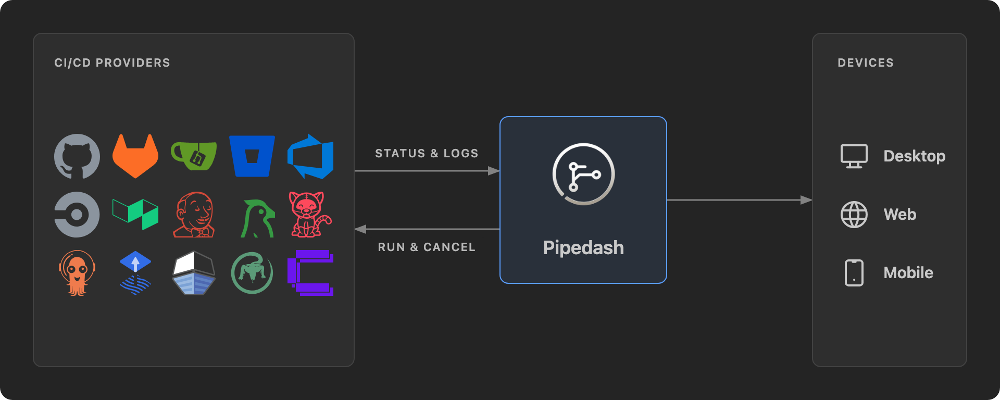
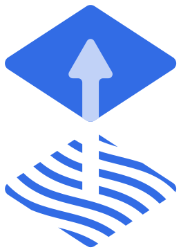
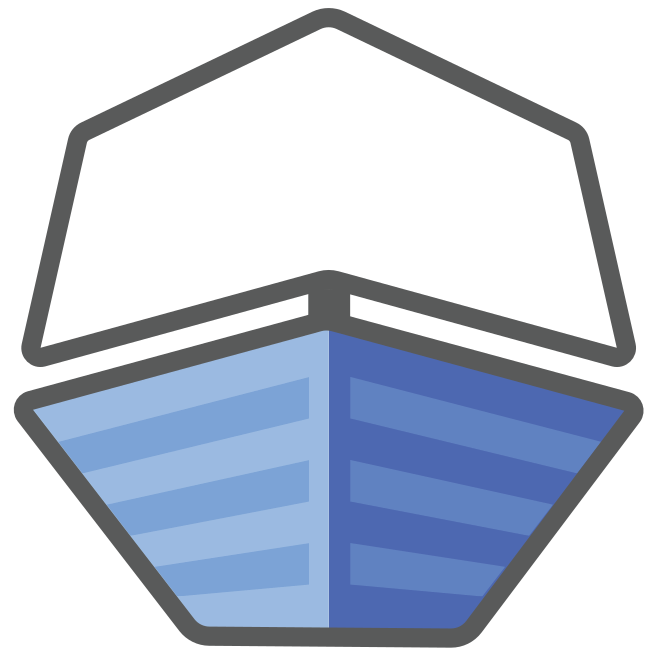

   
  
  <h3>Pipedash</h3>
  
One dashboard for the CI/CD pipelines of every provider you use.

  <a href="https://pipedash.app">Website</a> | <a href="https://demo.pipedash.app">Live Demo</a> | <a href="https://pipedash.app/downloads">Downloads</a> | <a href="https://pipedash.app/docs">Docs</a>
    
  
    
  
  
  
  
   
  
  
    

  

## About

Pipedash shows the pipelines of all your CI/CD providers in one table, so you stop switching between dashboards to find the build that failed. It polls each provider with the token or kubeconfig you add and caches the results. From the same table you open, trigger, rerun and cancel runs.

It runs as a desktop app, as a self-hosted web server in Docker or as an iOS and Android app. All of them share one Rust core.

### Supported providers

<table>
  <tr>
    <td align="center" valign="top" width="150"><a href="https://pipedash.app/docs/providers/github-actions"> <b>GitHub&nbsp;Actions</b></a></td>
    <td align="center" valign="top" width="150"><a href="https://pipedash.app/docs/providers/gitlab-ci"> <b>GitLab&nbsp;CI</b></a></td>
    <td align="center" valign="top" width="150"><a href="https://pipedash.app/docs/providers/gitea-actions"> <b>Gitea&nbsp;Actions</b></a></td>
    <td align="center" valign="top" width="150"><a href="https://pipedash.app/docs/providers/bitbucket-pipelines"> <b>Bitbucket&nbsp;Pipelines</b></a></td>
    <td align="center" valign="top" width="150"><a href="https://pipedash.app/docs/providers/azure-devops"> <b>Azure&nbsp;DevOps</b></a></td>
  </tr>
  <tr>
    <td align="center" valign="top" width="150"><a href="https://pipedash.app/docs/providers/circleci"> <b>CircleCI</b></a></td>
    <td align="center" valign="top" width="150"><a href="https://pipedash.app/docs/providers/buildkite"> <b>Buildkite</b></a></td>
    <td align="center" valign="top" width="150"><a href="https://pipedash.app/docs/providers/jenkins"> <b>Jenkins</b></a></td>
    <td align="center" valign="top" width="150"><a href="https://pipedash.app/docs/providers/woodpecker"> <b>Woodpecker&nbsp;CI</b></a></td>
    <td align="center" valign="top" width="150"><a href="https://pipedash.app/docs/providers/tekton"> <b>Tekton&nbsp;CD</b></a></td>
  </tr>
  <tr>
    <td align="center" valign="top" width="150"><a href="https://pipedash.app/docs/providers/argocd"> <b>ArgoCD</b></a></td>
    <td align="center" valign="top" width="150"><a href="https://pipedash.app/docs/providers/fluxcd"> <b>FluxCD</b></a></td>
    <td align="center" valign="top" width="150"><a href="https://pipedash.app/docs/providers/prow"> <b>Prow</b></a></td>
    <td align="center" valign="top" width="150"><a href="https://pipedash.app/docs/providers/komodo"> <b>Komodo</b></a></td>
    <td align="center" valign="top" width="150"><a href="https://pipedash.app/docs/providers/coolify"> <b>Coolify</b></a></td>
  </tr>
</table>

## Features

<table>
  <tr>
    <td align="center" width="120"> <b>Monitor</b></td>
    <td width="420">See the status of every pipeline in one place.</td>
    <td width="264"><a href="https://pipedash.app/docs/features/dashboard">Dashboard</a> <a href="https://pipedash.app/docs/features/provider-health">Provider health</a> <a href="https://pipedash.app/docs/features/refresh">Refresh</a></td>
  </tr>
  <tr>
    <td align="center" width="120"> <b>Organize</b></td>
    <td width="420">Group pipelines into saved views with rules, pins and bulk actions.</td>
    <td width="264"><a href="https://pipedash.app/docs/features/views">Views</a></td>
  </tr>
  <tr>
    <td align="center" width="120"> <b>Investigate</b></td>
    <td width="420">Find out why a run failed.</td>
    <td width="264"><a href="https://pipedash.app/docs/features/run-logs">Run logs</a> <a href="https://pipedash.app/docs/features/metrics">Metrics</a></td>
  </tr>
  <tr>
    <td align="center" width="120"> <b>Act</b></td>
    <td width="420">Start a workflow with inputs or stop a run.</td>
    <td width="264"><a href="https://pipedash.app/docs/features/trigger-and-cancel">Trigger and cancel</a></td>
  </tr>
  <tr>
    <td align="center" width="120"> <b>Notify</b></td>
    <td width="420">Get an alert when a pipeline fails or recovers.</td>
    <td width="264"><a href="https://pipedash.app/docs/features/notifications">Notifications</a></td>
  </tr>
</table>

## Get started

- **Install** it with the [installation guide](https://pipedash.app/docs/getting-started/installation).
- **Add a provider** with the [quick start](https://pipedash.app/docs/getting-started/quick-start).
- **Run** it on [desktop](https://pipedash.app/docs/deployment/desktop), [mobile](https://pipedash.app/docs/deployment/mobile) or [Docker](https://pipedash.app/docs/deployment/docker).
- **Share** one server through [Server mode](https://pipedash.app/docs/deployment/server-mode), a [reverse proxy](https://pipedash.app/docs/deployment/reverse-proxy) or the [REST API](https://pipedash.app/docs/deployment/rest-api).
- **Configure** [settings](https://pipedash.app/docs/configuration), [storage](https://pipedash.app/docs/configuration/storage-backends), [tokens](https://pipedash.app/docs/configuration/token-storage) and the [cache](https://pipedash.app/docs/features/cache).

## Screenshots

<b>Desktop and web</b> (9 pages)

<table>
  <tr>
    <td align="center" width="33%"><b>Pipelines</b> </td>
    <td align="center" width="33%"><b>Run history</b> </td>
    <td align="center" width="33%"><b>Run details</b> </td>
  </tr>
  <tr>
    <td align="center" width="33%"><b>Job logs</b> </td>
    <td align="center" width="33%"><b>Trigger a workflow</b> </td>
    <td align="center" width="33%"><b>Metrics</b> </td>
  </tr>
  <tr>
    <td align="center" width="33%"><b>Provider status</b> </td>
    <td align="center" width="33%"><b>Notifications</b> </td>
    <td align="center" width="33%"><b>Providers</b> </td>
  </tr>
</table>

<b>Mobile</b> (9 pages)

<table>
  <tr>
    <td align="center" width="33%"><b>Pipelines</b> </td>
    <td align="center" width="33%"><b>Run history</b> </td>
    <td align="center" width="33%"><b>Run details</b> </td>
  </tr>
  <tr>
    <td align="center" width="33%"><b>Job logs</b> </td>
    <td align="center" width="33%"><b>Trigger a workflow</b> </td>
    <td align="center" width="33%"><b>Metrics</b> </td>
  </tr>
  <tr>
    <td align="center" width="33%"><b>Provider status</b> </td>
    <td align="center" width="33%"><b>Notifications</b> </td>
    <td align="center" width="33%"><b>Providers</b> </td>
  </tr>
</table>

## Contributing

- **Contribute** through the [contribution guide](https://pipedash.app/docs/resources/contributing) and [GitHub issues](https://github.com/hcavarsan/pipedash/issues).
- **Build** locally with the [development guide](https://pipedash.app/docs/resources/development). Run `mise install` first.
- **Write a plugin** for a new provider with [plugin development](https://pipedash.app/docs/resources/plugin-development).
- **Learn** the [architecture](https://pipedash.app/docs/resources/architecture) and the [security model](https://pipedash.app/docs/resources/security).
- **Get help** from [support](https://pipedash.app/support).

## License

Pipedash is licensed under [GPL-3.0](LICENSE).

## Star History

<a href="https://star-history.com/#hcavarsan/pipedash&Date">
 <picture>
   <source media="(prefers-color-scheme: dark)" srcset="https://api.star-history.com/svg?repos=hcavarsan/pipedash&type=Date&theme=dark" />
   <source media="(prefers-color-scheme: light)" srcset="https://api.star-history.com/svg?repos=hcavarsan/pipedash&type=Date" />
   
 </picture>
</a>

## Contributors

