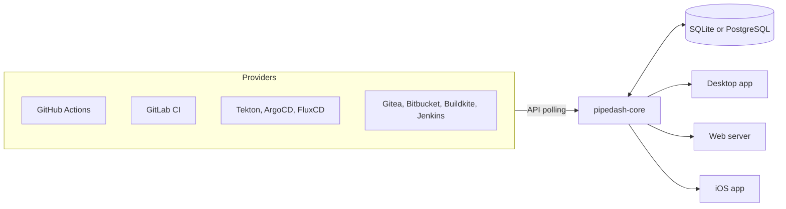

   
  
  <h1>Pipedash</h1>
  
One dashboard for the CI/CD pipelines of every provider you use.

  <a href="https://pipedash.app">Website</a> | <a href="https://pipedash.app/downloads">Downloads</a> | <a href="https://pipedash.app/docs">Docs</a>
    
  
  
  
    
  
    

  

## About

Pipedash shows the pipelines of all your CI/CD providers in one table, so you stop switching between dashboards to find the build that failed. It polls each provider with the token or kubeconfig you add and caches the results. From the same table you open, trigger, rerun and cancel runs.

It runs as a desktop app, as a self-hosted web server in Docker or as an iOS app. All three share one Rust core.

## Screenshots

<b>Desktop and web</b> (9 pages)

<h4>Pipelines</h4>

Every provider in one table, grouped by repository, with pinned workflows on top.

<h4>Run history</h4>

Commits, branches, actors and durations of each run.

<h4>Run details</h4>

Status, commit, branch and duration of one run.

<h4>Job logs</h4>

Steps, errors and search in the job log.

<h4>Trigger a workflow</h4>

The inputs Pipedash loads from the provider.

<h4>Metrics</h4>

Run duration, success rate and run count over time.

<h4>Provider status</h4>

The provider's status page and open incidents.

<h4>Notifications</h4>

Failed runs and provider outages in one inbox.

<h4>Providers</h4>

Connected providers, their status and refresh interval.

<b>Mobile</b> (9 pages)

<table>
  <tr>
    <td align="center" width="33%"><b>Pipelines</b> </td>
    <td align="center" width="33%"><b>Run history</b> </td>
    <td align="center" width="33%"><b>Run details</b> </td>
  </tr>
  <tr>
    <td align="center" width="33%"><b>Job logs</b> </td>
    <td align="center" width="33%"><b>Trigger a workflow</b> </td>
    <td align="center" width="33%"><b>Metrics</b> </td>
  </tr>
  <tr>
    <td align="center" width="33%"><b>Provider status</b> </td>
    <td align="center" width="33%"><b>Notifications</b> </td>
    <td align="center" width="33%"><b>Providers</b> </td>
  </tr>
</table>

## Supported providers

GitHub Actions, Gitea Actions, GitLab CI, Bitbucket Pipelines, Buildkite, Jenkins, Tekton CD, ArgoCD and FluxCD. Each one is a plugin crate. The [providers guide](https://pipedash.app/docs/providers) lists the token and permissions each provider needs.

## Features

- See the status of every pipeline, grouped by repository and workflow, and pin the ones you watch most. Hide a workflow you don't watch, and it leaves the table and its repository's status until you unhide it under Show hidden.
- Open the run history with commits, branches and durations, and track build metrics per pipeline.
- Read, search and download job logs of GitHub Actions and Buildkite runs without leaving Pipedash. Buildkite tokens need the `read_build_logs` scope.
- Open an ArgoCD sync to read its per-resource results, the app's recent events and the last 1000 lines of each pod container. A restarted container also shows its previous attempt. Pod logs need the `logs, get` permission in ArgoCD RBAC.
- Trigger a workflow with the inputs Pipedash loads from the provider, or rerun a past run with the same inputs.
- Cancel one run or several at once. On GitHub, approve deployment reviews and rerun only the failed jobs.
- Get a notification when a pipeline fails, a run takes far longer than usual or a provider has an outage.
- Keep provider tokens in the system keyring or in a database encrypted with AES-256-GCM. Pipedash sends no analytics or telemetry.

## Get started

Download the [desktop app](https://pipedash.app/downloads), install the [iOS app](https://apps.apple.com/br/app/pipedash-ci-cd-monitoring/id6757285870?l=en-GB) or run the [Docker image](https://pipedash.app/docs/deployment/docker). The [quick start](https://pipedash.app/docs/getting-started/quick-start) walks through your first provider.

- [Configuration](https://pipedash.app/docs/configuration): `config.toml`, environment variables and secrets.
- [Storage and tokens](https://pipedash.app/docs/configuration/storage-backends): SQLite, PostgreSQL and token encryption.
- [REST API](https://pipedash.app/docs/deployment/rest-api): routes, authentication and WebSocket events.
- [Architecture](https://pipedash.app/docs/resources/architecture): crates, refresh loop and plugin system.
- [Security](https://pipedash.app/docs/resources/security): encryption, API authentication and vulnerability reports.
- [Releases](https://github.com/hcavarsan/pipedash/releases): changes and release assets.

## Contributing

Read the [contribution guide](https://pipedash.app/docs/resources/contributing). For local builds, see [development](https://pipedash.app/docs/resources/development). To add a CI/CD provider, see [plugin development](https://pipedash.app/docs/resources/plugin-development).

Report bugs or request features through [GitHub issues](https://github.com/hcavarsan/pipedash/issues). For help, see [support](https://pipedash.app/support).

## License

Pipedash is licensed under [GPL-3.0](LICENSE).

## Star History

<a href="https://star-history.com/#hcavarsan/pipedash&Date">
 <picture>
   <source media="(prefers-color-scheme: dark)" srcset="https://api.star-history.com/svg?repos=hcavarsan/pipedash&type=Date&theme=dark" />
   <source media="(prefers-color-scheme: light)" srcset="https://api.star-history.com/svg?repos=hcavarsan/pipedash&type=Date" />
   
 </picture>
</a>

## Contributors

